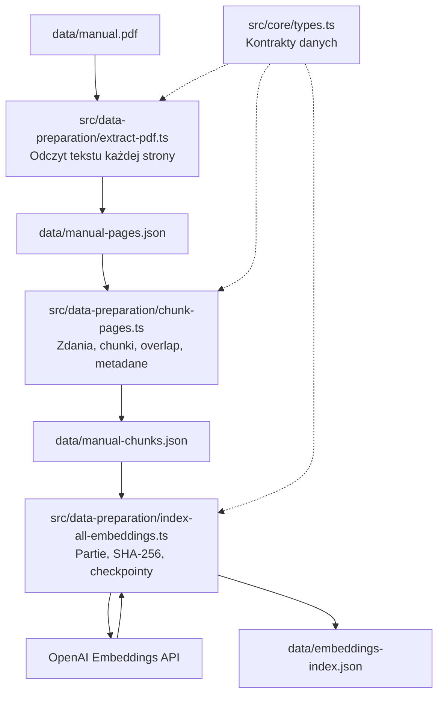
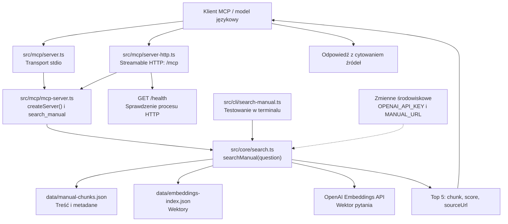

# car-mcp

Serwer [Model Context Protocol (MCP)](https://modelcontextprotocol.io/), który udostępnia wyszukiwanie semantyczne w instrukcji samochodu. Projekt jest przykładem przygotowania dokumentu PDF do wyszukiwania oraz udostępnienia wyników modelowi językowemu przez narzędzie `search_manual`.

Serwer zwraca pasujące fragmenty, podobieństwo, numery stron i opcjonalne linki do źródła. Model po stronie klienta MCP, np. Claude, może wykorzystać je do przygotowania odpowiedzi. Razem tworzy to prosty przepływ RAG: Retrieval-Augmented Generation.

README pełni rolę dokumentu projektowego. Opisuje obecną implementację, decyzje architektoniczne w formie zbliżonej do ADR, sposób uruchomienia i znane ograniczenia.

> Projekt jest przygotowany do lokalnego uruchamiania przez stdio, HTTP i Docker. Publiczne wdrożenie serwera wymaga dodatkowej konfiguracji hostów, HTTPS i uwierzytelniania. PDF i wygenerowane dane pozostają lokalne i nie są dostarczane w repozytorium.

## Spis treści

- [Zakres projektu](#zakres-projektu)
- [Architektura i połączenia plików](#architektura-i-połączenia-plików)
- [Odpowiedzialności plików](#odpowiedzialności-plików)
- [Decyzje architektoniczne](#decyzje-architektoniczne)
- [Wymagane narzędzia](#wymagane-narzędzia)
- [Konfiguracja projektu](#konfiguracja-projektu)
- [Uruchamianie i sprawdzanie MCP](#uruchamianie-i-sprawdzanie-mcp)
- [Docker](#docker)
- [Kontrakt narzędzia](#kontrakt-narzędzia)
- [Prywatność i publikacja](#prywatność-i-publikacja)
- [Ograniczenia i dalszy rozwój](#ograniczenia-i-dalszy-rozwój)
- [Rozwiązywanie problemów](#rozwiązywanie-problemów)

## Zakres projektu

Projekt obejmuje dwa niezależnie uruchamiane procesy:

1. **Przygotowanie wiedzy:** odczyt PDF, podział tekstu, wygenerowanie embeddingów i zapis indeksu.
2. **Obsługa pytania:** embedding pytania, lokalny ranking fragmentów i odpowiedź narzędzia MCP.

Po przygotowaniu danych serwer nie musi ponownie parsować PDF ani generować embeddingów instrukcji. Przy każdym pytaniu korzysta z zapisanych danych i oblicza tylko wektor pytania.

Pierwotny zestaw roboczy obejmował 821 stron i 1763 chunki. Liczba wynikowych fragmentów zależy od dokumentu oraz konfiguracji chunkowania.

## Architektura i połączenia plików

### Przygotowanie danych

Strzałki w tym diagramie oznaczają przepływ danych. Skrypty uruchamiane są kolejno przez użytkownika; serwer nie wykonuje automatycznie całego pipeline'u podczas startu.



### Działanie serwera

Strzałki pokazują wywołania i zależności. Oba transporty korzystają z tej samej definicji narzędzia i funkcji wyszukującej.



`src/core/types.ts` dostarcza również typy używane przez `src/core/search.ts`. Link `sourceUrl` może prowadzić do PDF na S3 lub innym serwerze HTTP/HTTPS. Serwer wyszukujący nie pobiera tego pliku przy każdym pytaniu.

## Odpowiedzialności plików

Kod jest podzielony według sposobu użycia. `core/` zawiera logikę i typy współdzielone przez pozostałe części aplikacji.

```text
src/
├── data-preparation/
│   ├── extract-pdf.ts
│   ├── chunk-pages.ts
│   └── index-all-embeddings.ts
├── mcp/
│   ├── mcp-server.ts
│   ├── server.ts
│   └── server-http.ts
├── cli/
│   └── search-manual.ts
└── core/
    ├── search.ts
    └── types.ts
```

| Plik | Rola i zależności |
|---|---|
| [src/data-preparation/extract-pdf.ts](src/data-preparation/extract-pdf.ts) | Czyta lokalny PDF przez `pdfjs-dist`, zapisuje tekst i numery stron. |
| [src/data-preparation/chunk-pages.ts](src/data-preparation/chunk-pages.ts) | Czyta strony JSON, dzieli tekst na chunki, dodaje identyfikatory i flagę ostrzeżeń. |
| [src/data-preparation/index-all-embeddings.ts](src/data-preparation/index-all-embeddings.ts) | Czyta chunki, wybiera nowe lub zmienione fragmenty, generuje embeddingi i zapisuje checkpointy. |
| [src/core/search.ts](src/core/search.ts) | Łączy indeks z treścią, oblicza podobieństwo do pytania i buduje linki do stron PDF. |
| [src/cli/search-manual.ts](src/cli/search-manual.ts) | Wywołuje tę samą funkcję wyszukiwania z argumentem przekazanym w terminalu. |
| [src/mcp/mcp-server.ts](src/mcp/mcp-server.ts) | Tworzy serwer MCP, definiuje schemat wejścia i obsługuje `search_manual`. |
| [src/mcp/server.ts](src/mcp/server.ts) | Uruchamia wspólną fabrykę serwera przez stdio. |
| [src/mcp/server-http.ts](src/mcp/server-http.ts) | Podłącza fabrykę przez adapter HTTP, obsługuje `/health`, waliduje Host i Origin. |
| [src/core/types.ts](src/core/types.ts) | Definiuje `ManualPage`, `ManualChunk`, `EmbeddedChunk` i `IndexedChunk`. |
| [package.json](package.json) | Deklaruje zależności, ESM oraz polecenia budowania i uruchamiania. |
| [package-lock.json](package-lock.json) | Zapisuje wersje zależności odtwarzane przez `npm ci`. |
| [tsconfig.json](tsconfig.json) | Określa kompilację `src/` do `dist/` i zasady kontroli typów. |
| [Dockerfile](Dockerfile) | Buduje aplikację i przygotowuje obraz uruchomieniowy. |
| [.dockerignore](.dockerignore) | Ogranicza pliki przekazywane do budowania obrazu. |
| [.gitignore](.gitignore) | Wyklucza lokalne sekrety, całe `data/`, zależności i wyniki kompilacji z Git. |
| [.env.example](.env.example) | Dokumentuje zmienne środowiskowe bez rzeczywistych wartości. |
| [.prettierrc](.prettierrc) | Zawiera ustawienia formatowania kodu. |

Pliki powstające lokalnie:

| Ścieżka | Kiedy jest potrzebna |
|---|---|
| `data/manual.pdf` | Dokument źródłowy wymagany przez ekstraktor. |
| `data/manual-pages.json` | Wynik ekstrakcji, wejście chunkowania. |
| `data/manual-chunks.json` | Wejście indeksowania i dane używane przy wyszukiwaniu. |
| `data/embeddings-index.json` | Zapisane wektory używane przy wyszukiwaniu. |
| `data/embeddings-index.json.tmp` | Tymczasowy plik zapisu checkpointu. |
| `dist/` | Skompilowane `.js` i mapy źródeł; powstaje po `npm run build`. |

## Decyzje architektoniczne

Status poniższych decyzji: **przyjęte i odzwierciedlone w obecnym kodzie**. Ograniczenia implementacji wymieniono przy decyzjach i w osobnej sekcji na końcu.

### ADR-001: Oddzielne przygotowanie danych i wyszukiwanie

**Kontekst:** instrukcja jest duża, natomiast pojedyncze pytanie dotyczy zwykle niewielkiego fragmentu.

**Decyzja:** PDF przetwarzamy wcześniej, a serwer używa gotowych chunków i wektorów. Logikę wyszukiwania umieszczamy w niezależnej funkcji `searchManual`.

**Uzasadnienie:** obliczanie tych samych embeddingów instrukcji dla każdego pytania powtarzałoby pracę i zużycie API. Osobne etapy ułatwiają też sprawdzanie danych pośrednich.

**Konsekwencje:** przed pierwszym uruchomieniem wyszukiwania trzeba przygotować indeks. Po zmianie dokumentu trzeba go zaktualizować.

### ADR-002: Tekst stron PDF jako format pośredni

**Kontekst:** potrzebujemy przeszukiwalnego tekstu i możliwości wskazania źródła.

**Decyzja:** `pdfjs-dist` odczytuje stronę po stronie. Teksty z `getTextContent()` łączymy spacjami i zapisujemy w JSON wraz z numerami stron.

**Uzasadnienie:** zapis stron pozwala ocenić ekstrakcję i ponawiać chunkowanie bez ponownego parsowania PDF.

**Konsekwencje:** nie zachowujemy pełnej geometrii tabel, rysunków ani układu kolumn. Projekt nie implementuje OCR. Przy skanach lub złożonych tabelach potrzebny byłby dodatkowy etap. Oryginalny PDF pozostaje źródłem do wizualnej weryfikacji.

### ADR-003: Chunki ze zdań, z nakładaniem treści

**Kontekst:** fragment powinien być dość mały, aby precyzyjnie dopasować temat, i dość duży, aby zachować kontekst.

**Decyzja:** dzielimy każdą stronę na zdania przez `Intl.Segmenter('pl')`. Docelowy rozmiar chunka wynosi 120 słów, a overlap około 25 słów. Identyfikator ma postać `page-676-chunk-1`.

**Uzasadnienie:** całe zdania ograniczają urywanie warunków procedury, a overlap zachowuje część kontekstu na granicy fragmentów. Granice stron upraszczają cytowanie.

**Konsekwencje:** wartości 120 i 25 są przybliżone; długie zdanie może przekroczyć docelowy rozmiar. Nakładanie zwiększa ilość indeksowanego tekstu. Procedury przechodzące między stronami pozostają rozdzielone. Parametry są punktem wyjścia, nie wynikiem benchmarku jakości.

### ADR-004: Wyszukiwanie semantyczne przez embeddingi

**Kontekst:** użytkownik może pytać innymi słowami niż autor instrukcji.

**Decyzja:** pytania i fragmenty reprezentujemy przez `text-embedding-3-small`, z 1536 wymiarami i formatem `float`.

**Uzasadnienie:** porównywanie wektorów pozwala wyszukiwać podobne znaczeniowo treści przy różnych sformułowaniach. Pytanie i indeks muszą używać zgodnego modelu i wymiaru. Konfigurację embeddingów opisuje [OpenAI Docs](https://developers.openai.com/api/docs/guides/embeddings).

**Konsekwencje:** przygotowanie indeksu i każde pytanie wymagają dostępu do API. Przy indeksowaniu wysyłamy tekst fragmentów; przy pytaniu tylko tekst pytania. Zmiana modelu wymaga zgodnego indeksu.

### ADR-005: JSON i pełne porównanie cosine similarity

**Kontekst:** przykład ma być łatwy do uruchomienia i zrozumienia przy niewielkim zbiorze dokumentów.

**Decyzja:** przechowujemy wektory w JSON, porównujemy pytanie ze wszystkimi wpisami i wybieramy maksymalnie pięć najlepszych wyników. Treści chunków dołączamy po `chunkId`.

**Uzasadnienie:** upraszcza to infrastrukturę i pokazuje działanie wyszukiwania bez dodatkowej usługi bazodanowej. Cosine similarity porównuje kierunki wektorów przez iloczyn skalarny i długości wektorów.

**Konsekwencje:** koszt porównań rośnie wraz z liczbą fragmentów i wymiarów. Aktualny kod ponownie odczytuje indeks dla każdego pytania. Wynik podobieństwa nie jest procentową pewnością odpowiedzi; ranking nie odtwarza kolejności kroków instrukcji. Brakuje progu odrzucania słabo dopasowanych wyników.

### ADR-006: Partie, SHA-256 i checkpointy indeksowania

**Kontekst:** indeksowanie może zostać przerwane, a niezmienione fragmenty powinny wykorzystywać zapisane wektory.

**Decyzja:** wysyłamy partie po 20 fragmentów. Wpis przechowuje model, identyfikator, wektor i SHA-256 treści. Po każdej partii zapisujemy plik tymczasowy, a następnie podmieniamy indeks przez `rename`.

**Uzasadnienie:** częste checkpointy umożliwiają wznowienie od zapisanego postępu, a hash rozpoznaje zmianę treści pod tym samym identyfikatorem.

**Konsekwencje:** po udanym API i nieudanym zapisie partia może zostać wygenerowana ponownie. Kod nie usuwa jeszcze wpisów po skasowanych chunkach i nie chroni przed dwoma równoczesnymi indeksowaniami.

### ADR-007: Wspólne narzędzie MCP i dwa transporty

**Kontekst:** chcemy sprawdzać tę samą funkcję lokalnie i przez interfejs HTTP.

**Decyzja:** `createServer()` rejestruje narzędzie, a osobne pliki startowe podłączają je przez stdio lub Streamable HTTP. HTTP korzysta z `node:http` i adaptera SDK MCP.

**Uzasadnienie:** transport nie powiela logiki domenowej. Osobny skrypt terminalowy umożliwia sprawdzanie wyszukiwania bez protokołu MCP.

**Konsekwencje:** stdio wymaga zachowania standardowego wyjścia dla protokołu, więc diagnostyka trafia do `console.error`. Wariant HTTP ma lokalną walidację Host/Origin i prosty `/health`, ale nie ma jeszcze uwierzytelniania publicznego serwera.

### ADR-008: RAG z generowaniem odpowiedzi po stronie klienta

**Kontekst:** różne klienty MCP mogą korzystać z wyszukiwarki i własnego modelu językowego.

**Decyzja:** serwer wykonuje retrieval i przekazuje kontekst. Odpowiedź formułuje model klienta, np. Claude.

**Uzasadnienie:** utrzymujemy jeden zakres odpowiedzialności serwera: odnajdywanie źródeł. Klient wykorzystuje narzędzie w swojej rozmowie i decyduje, jak przedstawić odpowiedź.

**Konsekwencje:** sam wynik Inspectora obejmuje tylko wyszukiwanie. Pełny przepływ RAG występuje, gdy klient używa fragmentów w generacji. Pole `tokens` dotyczy embeddingu pytania, nie całej rozmowy ani kosztu odpowiedzi klienta.

### ADR-009: Dwie numeracje stron i konfigurowalny link do źródła

**Kontekst:** numer wydrukowany w instrukcji różni się od pozycji strony w pliku.

**Decyzja:** użytkownikowi cytujemy `printedPage`, a link `#page=...` budujemy z `pdfPage`. Bazowy adres dokumentu pochodzi z `MANUAL_URL`.

**Uzasadnienie:** cytowanie odpowiada numerowi widocznemu na stronie, natomiast czytnik otrzymuje właściwą pozycję w PDF. Hosting dokumentu pozostaje konfiguracją środowiska.

**Konsekwencje:** obecny ekstraktor zakłada `printedPage = pdfPage - 1`; dla innego PDF trzeba sprawdzić mapowanie. Dokument wskazany w `MANUAL_URL` musi odpowiadać wersji użytej do indeksowania. Bez zmiennej `sourceUrl` wynosi `null`. Link HTTP nie jest zarejestrowanym resource MCP; resources nie zostały jeszcze zaimplementowane.

### ADR-010: TypeScript, ESM i obraz budowany bez sekretów

**Kontekst:** potrzebujemy spójnego środowiska, czytelnych kontraktów i powtarzalnego uruchamiania.

**Decyzja:** używamy Node.js 24, ESM, `target: ES2024`, ścisłych flag TypeScriptu i kompilacji do `dist/`. Docker ma etapy build oraz runtime. Sekrety podajemy przy uruchomieniu.

**Uzasadnienie:** TypeScript wykrywa błędy kontraktów i nieużywane elementy, lockfile utrwala wersje zależności, a kontener odtwarza środowisko. Osobne etapy ograniczają zawartość obrazu uruchomieniowego.

**Konsekwencje:** obraz wymaga gotowych danych wyszukiwania. `.env` jest wykluczony z Git i budowania. Obraz uruchamia proces jako użytkownik `node`. Kod nadal wymaga uruchomienia z katalogu projektu; kontener zapewnia ten układ przez `WORKDIR /app`.

## Wymagane narzędzia

| Narzędzie lub zasób | Czy jest wymagany | Zastosowanie |
|---|---|---|
| Node.js 24.x | Tak | Uruchamianie skryptów, kompilatora i serwera; ta wersja jest także w Dockerfile. |
| npm dołączone do Node.js | Tak | Instalacja zależności i polecenia `build` / `start`. |
| Git | Do pracy z repozytorium | Klonowanie i wersjonowanie. |
| Klucz OpenAI API z dostępem do embeddings | Tak | Indeksowanie i wektor każdego pytania. |
| Lokalny PDF z warstwą tekstową | Przy pierwszym przygotowaniu danych | Wejście do `extract-pdf.ts`. |
| Klient MCP, np. MCP Inspector lub Claude | Do korzystania z MCP | Odkrywanie i wywoływanie narzędzia. |
| Docker Engine / Docker Desktop | Opcjonalnie | Budowanie i uruchamianie kontenera. |
| Hosting HTTP/HTTPS oryginalnego PDF | Opcjonalnie | Aktywne odnośniki do stron przez `MANUAL_URL`. |

TypeScript, `tsx`, SDK OpenAI, SDK MCP, Zod i zależności PDF instaluje `npm ci`. Nie trzeba instalować ich globalnie. AWS CLI, baza wektorowa ani Python nie są potrzebne do lokalnego działania projektu.

## Konfiguracja projektu

Poniższe polecenia są przeznaczone dla bash/zsh. Uruchamiaj je z katalogu projektu, ponieważ kod odczytuje `data/...` względem bieżącego katalogu procesu.

### 1. Pobierz projekt i zależności

W poleceniu klonowania zastąp placeholder adresem tego repozytorium:

```bash
git clone <URL_REPOZYTORIUM>
cd car-mcp
npm ci
```

### 2. Przygotuj lokalne zmienne środowiskowe

W świeżo sklonowanym projekcie skopiuj szablon:

```bash
cp .env.example .env
```

Jeżeli masz już własny `.env`, zachowaj go i uzupełnij potrzebne pola zamiast nadpisywać plik szablonem.

W edytorze ustaw `OPENAI_API_KEY` na swój klucz. Opcjonalnie ustaw `MANUAL_URL` na adres dokładnie tej samej instrukcji PDF, którą będziesz indeksować.

Przykład struktury konfiguracji, bez rzeczywistych sekretów:

```dotenv
OPENAI_API_KEY=
MANUAL_URL=https://example.com/manual.pdf
```

Adres `example.com` jest demonstracyjny; zastąp go swoim adresem albo pozostaw `MANUAL_URL` puste.

| Zmienna | Znaczenie | Domyślne zachowanie |
|---|---|---|
| `OPENAI_API_KEY` | Klucz SDK OpenAI | Wymagany; klient tworzony jest również przy starcie serwera. |
| `MANUAL_URL` | Adres HTTP/HTTPS oryginalnego PDF | Opcjonalny; brak linków przy pustej wartości. |
| `HOST` | Adres nasłuchiwania HTTP | `127.0.0.1`, a w obrazie Dockera `0.0.0.0`. |
| `PORT` | Port HTTP | `3000`. |
| `DOTENV_CONFIG_QUIET` | Wyciszenie komunikatów dotenv | W przykładach MCP i obrazie ustawiane na `true`. |

### 3. Dostarcz PDF

```bash
mkdir -p data
```

Umieść instrukcję w `data/manual.pdf`. Repozytorium nie pobiera jej automatycznie. Cały katalog `data/` jest ignorowany przez Git.

Domyślne ustawienia obejmują polską segmentację zdań i stały offset numeracji stron. Dla wgranej instrukcji samochodu należy sprawdzić zgodność języka, mapowania numerów stron i jakości ekstrakcji tekstu.

### 4. Wyodrębnij tekst stron

```bash
npx tsx src/data-preparation/extract-pdf.ts
```

Wynik: `data/manual-pages.json`. Sprawdź raport o stronach pustych oraz próbkę treści. Skan bez warstwy tekstowej wymaga OCR poza obecnym pipeline'em.

### 5. Utwórz chunki

```bash
npx tsx src/data-preparation/chunk-pages.ts
```

Wynik: `data/manual-chunks.json`. Zwróć uwagę na numery stron, czytelność tekstu i zachowanie tabel. Słowa liczone przez chunker nie są tokenami modelu.

### 6. Wygeneruj indeks

```bash
npx tsx src/data-preparation/index-all-embeddings.ts
```

Wynik: `data/embeddings-index.json`. Ten etap wysyła treść fragmentów do OpenAI i zużywa tokeny API. Postęp zapisywany jest po każdej partii. Ponowne uruchomienie wykorzystuje zapisane, niezmienione wpisy.

Oczekiwany układ lokalnych danych:

```text
data/
├── manual.pdf
├── manual-pages.json
├── manual-chunks.json
└── embeddings-index.json
```

Do samego wyszukiwania potrzebne są tylko ostatnie dwa pliki. PDF i strony JSON pozwalają odtworzyć wcześniejsze etapy.

### 7. Sprawdź wyszukiwanie i skompiluj aplikację

```bash
npx tsx src/cli/search-manual.ts "Jak sprawdzić poziom oleju silnikowego?"
npm run build
```

Wyszukiwanie wykonuje wywołanie embeddings dla pytania. Kompilacja generuje `dist/` i nie wywołuje API. Nie uruchamia też automatycznie skryptów indeksujących.

Jeżeli masz już zgodne chunki i indeks przygotowane z tej samej wersji dokumentu, możesz wykorzystać je bez powtarzania ekstrakcji i indeksowania.

## Uruchamianie i sprawdzanie MCP

### Streamable HTTP

Po kompilacji uruchom:

```bash
DOTENV_CONFIG_QUIET=true npm start
```

Domyślne adresy:

| Adres | Zastosowanie |
|---|---|
| `http://127.0.0.1:3000/mcp` | Endpoint protokołu MCP. |
| `http://127.0.0.1:3000/health` | Sprawdzenie działania procesu HTTP. |

W drugim terminalu:

```bash
curl -i http://127.0.0.1:3000/health
```

Oczekiwany status: `200`, treść: `{"status":"ok"}`. Ta trasa nie sprawdza poprawności indeksu ani dostępności API.

Uruchom MCP Inspector:

```bash
npx @modelcontextprotocol/inspector \
  --server-url http://127.0.0.1:3000/mcp \
  --transport http
```

Otwórz adres interfejsu wyświetlony w terminalu, połącz się i wybierz narzędzie `search_manual`. Podaj pytanie o kontrolę oleju lub ciśnienie w oponach. `npx` może przy pierwszym uruchomieniu poprosić o instalację Inspectora.

### Stdio

Wariant stdio może zostać uruchomiony przez klienta MCP poleceniem:

```bash
DOTENV_CONFIG_QUIET=true node dist/mcp/server.js
```

Przy samodzielnym uruchomieniu proces czeka na komunikaty klienta. Dla testu przez Inspector użyj:

```bash
DOTENV_CONFIG_QUIET=true npx @modelcontextprotocol/inspector node dist/mcp/server.js
```

Klient uruchamiający stdio powinien startować proces w katalogu projektu. Samo podanie bezwzględnej ścieżki do `server.js` nie zmienia katalogu roboczego i może spowodować błędy odczytu danych.

### Sprawdzenie odpowiedzi z modelem

Po podłączeniu narzędzia do klienta poproś model o użycie `search_manual`, odpowiedź na podstawie fragmentów i podanie źródeł. Dla fragmentu z `printedPage: 675` i `pdfPage: 676` oczekujemy cytowania „s. 675” z linkiem kończącym się na `#page=676`.

## Docker

Dockerfile oczekuje istniejących `data/manual-chunks.json` i `data/embeddings-index.json`. Przygotuj je przed budowaniem. Wymagany jest uruchomiony Docker Engine, np. przez Docker Desktop.

### Budowanie

```bash
docker build -t car-mcp:local .
```

Etap build instaluje zależności i kompiluje źródła. Etap runtime instaluje zależności produkcyjne, kopiuje `dist/` i dwa pliki danych. Oryginalny PDF i `.env` nie są kopiowane. Proces działa jako użytkownik `node`.

### Uruchomienie lokalne

Zatrzymaj wcześniej działający serwer zajmujący port 3000, a następnie:

```bash
docker run --rm --init \
  --name car-mcp-local \
  -p 127.0.0.1:3000:3000 \
  --env-file .env \
  car-mcp:local
```

`--env-file` przekazuje konfigurację dopiero przy uruchomieniu. Powiązanie portu z `127.0.0.1` udostępnia go lokalnie na komputerze. Wewnątrz kontenera aplikacja nasłuchuje na `0.0.0.0`, aby odbierać przekierowane połączenia.

Sprawdź `/health` i użyj tego samego połączenia HTTP w Inspectorze. Kontener zatrzymasz przez `Ctrl+C` w jego terminalu lub:

```bash
docker stop car-mcp-local
```

### Aktualizacja

- Po zmianie kodu przebuduj obraz i uruchom nowy kontener.
- Po zmianie wyłącznie `.env` odtwórz kontener z aktualnym środowiskiem.
- Po zmianie chunków lub indeksu przebuduj obraz, ponieważ dane są do niego kopiowane.

## Kontrakt narzędzia

Nazwa: `search_manual`.

Wejście:

```json
{
  "question": "Jak sprawdzić poziom oleju silnikowego?"
}
```

Zod usuwa skrajne białe znaki, odrzuca puste pytanie i ogranicza długość do 2000 znaków. Walidacja odbywa się przed wywołaniem funkcji wyszukującej.

Schematyczny przykład obiektu wynikowego, z jedną pozycją dla czytelności:

```json
{
  "results": [
    {
      "chunk": {
        "id": "page-676-chunk-1",
        "pdfPage": 676,
        "printedPage": 675,
        "content": "Przykładowy tekst odnalezionego fragmentu instrukcji.",
        "containsSafetyWarning": false
      },
      "score": 0.72,
      "sourceUrl": "https://example.com/manual.pdf#page=676"
    }
  ],
  "tokens": 13
}
```

Rzeczywista liczba wyników wynosi maksymalnie pięć, a podobieństwo i liczba tokenów zależą od zapytania. Obiekt jest serializowany do JSON i przekazywany w tekstowym bloku MCP `content`; nie jest obecnie zwracany przez `structuredContent`.

Przy błędzie wykonania narzędzie zwraca `isError: true` z ogólnym komunikatem. Szczegóły są logowane na stderr. Flaga `containsSafetyWarning` jest heurystyką opartą na trzech nagłówkach ostrzeżeń, a nie pełną klasyfikacją bezpieczeństwa.

## Prywatność i publikacja

- `.env` i jego warianty pozostają lokalne. `.env.example` zawiera puste pola i może być wersjonowany.
- Cały `data/`, `dist/`, `node_modules/`, logi i pliki systemowe są ignorowane przez Git.
- `.dockerignore` dopuszcza tylko pliki potrzebne do budowania; końcowe reguły wykluczają sekrety również z dozwolonych katalogów.
- Klucz OpenAI nie jest częścią Dockerfile ani argumentem budowania. `MANUAL_URL` także jest konfiguracją środowiska, bez prywatnego adresu infrastruktury w źródłach.
- Przy indeksowaniu do OpenAI trafia tekst chunków, a przy wyszukiwaniu tekst pytania. Wyniki z treścią instrukcji trafiają do klienta MCP.
- Zwykły publiczny adres PDF jest dostępny odbiorcom, którym zostanie przekazany w `sourceUrl`. Serwer nie dodaje do niego uwierzytelniania.

Reguły ignorowania służą publikacji przez Git i budowaniu obrazu. Przed udostępnieniem całego katalogu inną metodą trzeba osobno uwzględnić lokalne pliki wykluczone z repozytorium.

## Ograniczenia i dalszy rozwój

| Obszar | Obecne ograniczenie / następny krok |
|---|---|
| Aktualizacja indeksu | Wpisy po usuniętych chunkach pozostają w indeksie i mogą blokować wyszukiwanie. Potrzebne jest ich czyszczenie także przy braku nowych partii. |
| Spójność treści | Wyszukiwanie sprawdza model, wymiar i istnienie chunka, ale nie porównuje `contentHash`. Po zmianie treści wymagane jest indeksowanie. |
| Walidacja danych | Typy TypeScript nie walidują JSON z dysku. Brakuje pełnych schematów, kontroli kompletności i wartości wektorów. |
| Wydajność | Indeks i chunki są ładowane ponownie dla każdego pytania; warto dodać kontrolowany cache na proces. |
| Trafność | Brakuje progu podobieństwa, deduplikacji, rerankingu i dołączania sąsiednich stron. |
| Tabele i warianty pojazdu | Ekstrakcja spłaszcza układ. Ranking nie filtruje wersji silnika ani wyposażenia. |
| Numery stron | Offset `-1` jest założeniem konkretnej instrukcji, nie uniwersalnym parserem numeracji. |
| HTTP | Walidacja dopuszcza lokalne hosty. Zdalne wdrożenie wymaga dostosowania oraz uwierzytelniania i HTTPS. |
| MCP resources | Rozważono resource PDF i resource template strony, ale obecnie serwer udostępnia tylko narzędzie. |
| Testy | `npm test` jest placeholderem kończącym się błędem. Brakuje stałych testów regresyjnych i zestawu pytań do oceny jakości. |
| Obraz runtime | Zależności do parsowania PDF nadal są w `dependencies` i trafiają do obrazu, choć wyszukiwanie ich nie używa. |
| Publikacja | `package.json` ma jeszcze pusty opis i nieaktualne `main: index.js`. Pole `license` deklaruje ISC; osobny plik `LICENSE` nie został dodany. |

Przydatne sprawdzenie typów bez generowania plików:

```bash
npx tsc --noEmit
```

## Rozwiązywanie problemów

| Objaw | Co sprawdzić |
|---|---|
| Brak klucza przy starcie | Czy `.env` jest w katalogu uruchomienia i zawiera `OPENAI_API_KEY`; przy Dockerze sprawdź `--env-file`. |
| `ENOENT` dla `data/...` | Czy przygotowano dane i czy proces działa w katalogu projektu. |
| Błąd `COPY` danych podczas budowania | Czy istnieją oba pliki JSON wymagane przez Dockerfile. |
| `EADDRINUSE` | Czy portu 3000 nie zajmuje poprzedni proces lub kontener. |
| `403` z endpointu MCP | Czy klient używa dozwolonego lokalnego hosta i originu. Publiczna domena nie jest jeszcze skonfigurowana. |
| `Brak treści dla chunka` | Czy indeks i chunki pochodzą z tego samego podziału; zobacz ograniczenie usuwania starych wpisów. |
| `sourceUrl: null` | Czy ustawiono niepuste `MANUAL_URL`. |
| Błąd URL | Czy `MANUAL_URL` jest pełnym adresem zaczynającym się od `http://` lub `https://`. |
| Link otwiera stronę z innym numerem | Porównaj `pdfPage` z `printedPage`; np. `#page=676` otwiera stronę z wydrukowanym numerem 675. |
| Brak widocznych zmian w kontenerze | Czy po zmianie kodu przebudowano obraz i utworzono nowy kontener. |
| Nieaktualny opis narzędzia w kliencie | Uruchom nową wersję serwera i odśwież połączenie/listę narzędzi MCP. |
